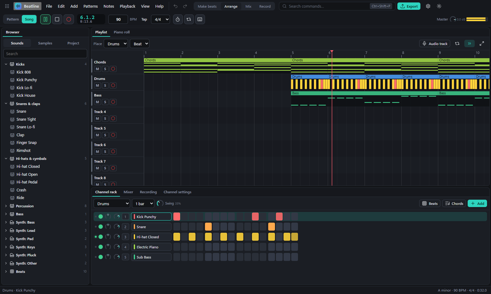

# Beatline

**A free music studio for Windows that works like FL Studio.** Program a beat in the channel rack, write melodies and chords in the piano roll, arrange your song in the playlist, plug in your guitar and record it through an amp, mix it with real effects, and export an MP3 that's ready for Spotify and YouTube.

Beatline is a sister app of [Gridline](https://github.com/LucasHeh47/gridline), [Pixelline](https://github.com/LucasHeh47/pixelline), [Frameline](https://github.com/LucasHeh47/frameline) and [Baseline](https://github.com/LucasHeh47/baseline), and shares their look.

## Download and install

1. Go to the **[releases](https://github.com/LucasHeh47/beatline/releases)**.
2. Under **Assets**, download one of these files:

   | File | What it is |
   | --- | --- |
   | **`Beatline-Setup-x.y.z.exe`** | **The installer (recommended).** It adds Beatline to the Start menu and the desktop, opens `.beatline` projects with a double-click, and updates itself. |
   | `Beatline-Portable-x.y.z.exe` | A single file you can run from anywhere without installing. It tells you when a new version is available. |

3. Run the file you downloaded. (If you use [Baseline](https://github.com/LucasHeh47/baseline), it can install Beatline for you.)

> **"Windows protected your PC"?** Beatline isn't signed with a paid code-signing certificate, so Windows SmartScreen may warn you the first time. Click **More info**, then **Run anyway**. Only download Beatline from this repository's Releases page.

**Requirements:** Windows 10 or 11 (64-bit). To record a guitar, an audio interface (or any input Windows sees); headphones help when you play along.

## What it does

**Making beats**

- **Channel rack and step sequencer**: every sound is a row; click or drag across steps to switch them on, with **swing** and patterns from 1 to 8 bars. **Beats** fills in a ready-made groove: house, rock, boom bap, trap, lo-fi, reggaeton, funk, drum & bass, disco or half-time.
- **128 recorded instruments**: grand and electric pianos, organs, acoustic, electric and distorted guitars, bass guitars, strings, choir, brass, saxes, flutes, bells, world instruments and more (the General MIDI set, from the FluidR3 Mono SoundFont). Softer notes sound softer and darker, as on the real thing.
- **Drums**: recorded acoustic, rock, room, jazz and brush kits and real percussion (congas, bongos, shaker, tambourine…), plus 24 electronic sounds made by Beatline itself: 808, punchy, lo-fi and house kicks, snares, claps, snaps, rimshots, hats, cymbals, toms, percussion and an 808 bass.
- **Synths** with 14 presets (sub and Reese bass, pluck bass, saw and chip leads, supersaw, warm pad, strings, electric piano, organ, bells, plucks, brass) and every knob to make your own: two oscillators with unison and FM, noise, a filter with its envelope, the volume envelope, an LFO, glide and mono.
- **Samplers**: drag any audio file onto the channel rack — a one-shot drum, or an instrument that follows the notes' pitch, with tuning, envelope, reverse and choke groups (an open hat stopped by the closed one).

**Writing music**

- **Piano roll**: draw notes (they play as you draw), drag to move and stretch them, right-click to erase, Ctrl+drag to select. Velocity, ghost notes of the other channels, and the song's **key shown as light rows**, with chord names written over your chords.
- **Chords made easy**: draw a whole chord in one click, turn single notes into the key's chords, or let **Chord progression** write one — pop, emotional, 50s, royal road, jazz, canon, dark pop, flamenco, trap or 12-bar blues — in any key, held, on the beat or arpeggiated, with a bass line.
- **Note tools**: quantize, humanize, legato, arpeggiate, strum and fit to the key.
- **Play live** on a **MIDI keyboard**, or on the **computer keyboard** (Ctrl+T: Z to M is one octave, Q to P the next) — and record what you play straight into the pattern.

**Arranging and recording**

- **Playlist**: place patterns and audio clips on tracks, move, copy, slice and trim them, fade audio in and out, and loop a section.
- **Record your guitar, bass or vocals**: pick your audio interface's input, hear yourself through the track's **guitar amp** and effects while you play, with a **metronome**, a **count-in** and automatic latency correction. Loop a section to record several **takes** in a row.
- **Tuner** for guitar (standard, drop D, half step down, DADGAD, open G), bass and ukulele.
- **Templates** to start from: an empty beat, hip-hop, trap, house, lo-fi and pop grooves that already play, a rock band with a guitar track ready to record, and a singer-songwriter setup.

**Mixing and sharing**

- **Mixer**: a track for every instrument and recording, with meters, faders, pan, mute and solo, and effects: EQ, compressor, noise gate, limiter, reverb, tempo-synced delay, **guitar amp with speaker cabinet** (clean, crunch, lead, metal, bass), distortion, chorus, phaser, filter and stereo width. Presets for guitar tones, acoustic guitar, bass, vocals, drums and the master.
- **Export** as WAV, MP3, M4A, OGG or FLAC, with the loudness set for streaming (−14 LUFS for Spotify and YouTube) and a limiter so nothing clips. **Stems**: every track as its own file. Patterns export as **MIDI** too.
- **Your sample folders** in the browser: click to hear, drag in to use.
- **Automatic saving and recovery** after a crash.

## Keyboard shortcuts

Every command is searchable with **Ctrl+Shift+P**, and **Help → Keyboard shortcuts** lists them all. The most useful:

| Keys | What they do |
| --- | --- |
| Space | Play / stop |
| L | Pattern / song mode |
| Ctrl+Shift+R | Record |
| Ctrl+M | Metronome |
| Ctrl+T | Play notes with the computer keyboard |
| F5 / F6 / F7 / F9 | Playlist / channel rack / piano roll / mixer |
| F4 | New pattern |
| Ctrl+B | Duplicate |
| Alt+Q | Quantize notes |
| Shift+T | Tap tempo |
| Ctrl+R | Export the song |

## Building it yourself

See **[docs/development.md](docs/development.md)**.

## License

[MIT](LICENSE)

The instruments come from the **FluidR3 Mono** General MIDI SoundFont (FluidR3 by Frank Wen, mono version by Michael Cowgill, adapted by S. Christian Collins), also under the MIT license: see [public/soundfonts/LICENSE-FluidR3Mono.md](public/soundfonts/LICENSE-FluidR3Mono.md).
